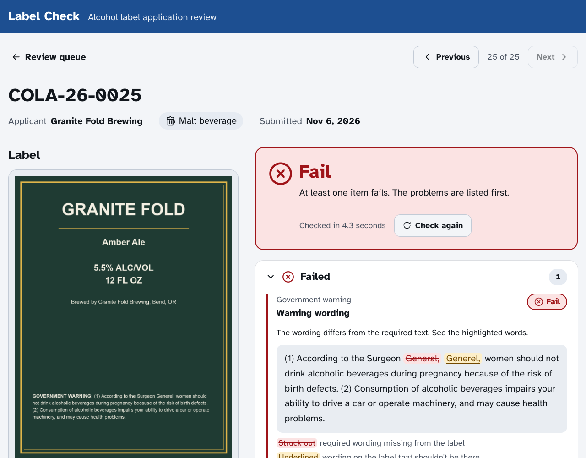

# Label Check: AI-assisted alcohol label verification

A prototype that does the "matching" half of a TTB label review. It reads the
label image, compares each field to the application, and checks the
Government Health Warning word-for-word. The agent gets a plain-English
verdict for every field.

**Deployed URL:** _add after deploying (see [Deploy](#deploy))_



---

## Quick start

```bash
# 1. System dependency for the offline OCR fallback
sudo apt-get install tesseract-ocr        # macOS: brew install tesseract

# 2. Python deps (Python 3.11+)
python -m venv .venv && source .venv/bin/activate
pip install -r requirements-dev.txt

# 3. Optional: enable the AI reader. Without a key, the app runs in offline-OCR mode.
export ANTHROPIC_API_KEY=sk-ant-...

# 4. Run
uvicorn app.main:app --reload
# open http://localhost:8000 and pick a label from the "Try an example" menu
```

Run the tests with `pytest`. There are 65 tests, and they need no API key or network (the models are scripted fakes).

Or with Docker: `docker build -t label-check . && docker run -p 8000:8000 -e ANTHROPIC_API_KEY=... label-check`

## Using it

* **Check one label:** upload a photo, type what the application says, and click **Check label**.
  Blank fields are skipped. The government warning is always checked.
* **Check many labels:** upload a CSV (one row per label, with a `filename` column) and select
  all the images. Results stream in as they finish, and you can filter to just the problems and
  download a results CSV. **Load the example labels** runs a demo batch.

Every result is one of:

| Result | Meaning |
|---|---|
| ✔ **Match** | Identical, or the same apart from capitalization or punctuation (noted) |
| ⚠ **Check** | Probably fine, but a human should look: a near-miss, unconfirmed bold type, or a hard-to-read photo |
| ✖ **Mismatch / Not found** | Clearly different, or absent from the label |

---

## Approach

**Every decision, with the options considered and the trade-offs, is in
[docs/DESIGN.md](docs/DESIGN.md).** This is the short version.

```
                ┌─► primary AI reader   (claude-opus-5-5)  ─┐  both in parallel,
 label image ───┤                                           ├─ 4.5 s deadline
                └─► secondary AI reader (claude-haiku-5-5) ─┘
                          │ nobody answered / network blocked
                          └─► offline Tesseract OCR (deskewed)
                                        │
            matching rules (plain, tested Python) run on each reading
                                        │
          consensus: a field can only PASS if every reader passed it
                                        │
                   verdict per field: PASS · REVIEW · FAIL
```

1. **The AI reads; code judges.** Models only transcribe into a fixed schema.
   Pass/fail comes from deterministic, unit-tested rules, so verdicts are
   explainable and a prompt change can't silently change policy. ([D2](docs/DESIGN.md#d2-the-ai-reads-plain-code-judges))
2. **Two independent AI readers ("double-keying").** The dangerous error is a
   *false PASS*, most likely caused by a model silently "fixing" a typo in the
   warning. One reader can't catch its own silent fix, but a second, *different*
   model rarely makes the same one. When they disagree, the field goes to
   REVIEW with both readings shown. Cost isn't the driver: at about 2¢ a label,
   150k labels a year is a few thousand dollars. ([D7](docs/DESIGN.md#d7-model-routing-two-independent-readers-double-keying), [D8](docs/DESIGN.md#d8-consensus-rules))
3. **Hybrid AI + offline OCR.** This covers Marcus's firewall concern: if the API
   is blocked, Tesseract runs locally, and the UI says so. OCR results are graded
   more cautiously, because OCR can't tell its misreads from real typos or see
   bold type. ([D4](docs/DESIGN.md#d4-hybrid-extraction-ai-first-offline-ocr-fallback), [D5](docs/DESIGN.md#d5-ocr-results-are-graded-more-cautiously))
4. **5-second budget.** Readers run in parallel under a hard deadline, with low
   thinking effort and downscaled images. **Real API latency is not yet measured**:
   run the benchmark. ([D10](docs/DESIGN.md#d10-the-5-second-budget))
5. **Judgment, not just pattern matching.** `STONE'S THROW` = `Stone's Throw`
   (passes with a note), numbers are compared as numbers (`70 cl` = `700 mL`), and
   the warning must match word-for-word, with a capitalized colon lead-in in bold.
   ([D14](docs/DESIGN.md#d14-text-field-matching)–[D16](docs/DESIGN.md#d16-the-government-warning-check))

### Benchmark

```bash
ANTHROPIC_API_KEY=... python scripts/benchmark.py --runs 3   # real, billed API calls
```

This scores each model alone and each primary+secondary pairing on the 12 sample
labels. It reports latency, exact warning transcription, silent corrections, bold
detection, false PASSes, review rate and cost, and writes them to
`docs/benchmark-results.md`. Use the results to choose `PRIMARY_MODEL`,
`SECONDARY_MODEL` and `READ_DEADLINE_SECONDS`.

## Project layout

```
app/
  main.py               HTTP routes (verify, parse-manifest, examples, health)
  consensus.py          reconciles the two AI readers' verdicts
  models.py             ApplicationData / ExtractedLabel / VerificationResult
  matching.py           field comparison rules + overall verdict
  warning.py            canonical warning text, exact-match check, word diff
  config.py             env-var settings
  extraction/
    __init__.py         parallel readers under a deadline + OCR fallback
    claude_reader.py    Claude vision, schema-constrained output
    ocr_reader.py       Tesseract + deskew + application-guided field finding
    image.py            decode, EXIF-rotate, downscale
  static/               index.html, app.js, styles.css
samples/                12 generated test labels + batch.csv ("expected_result", "what_this_tests")
scripts/generate_samples.py   regenerates the samples
scripts/benchmark.py    scores real models and pairings on the samples
tests/                  rule + consensus unit tests, API tests (real OCR, scripted fake models)
docs/DESIGN.md          decision log: every design choice and its trade-offs
```

## Configuration

| Variable | Default | |
|---|---|---|
| `ANTHROPIC_API_KEY` | – | Enables the AI readers |
| `EXTRACTION_MODE` | `auto` | `auto` / `claude` / `ocr` |
| `PRIMARY_MODEL` | `claude-opus-5-5` | Most-trusted reader |
| `SECONDARY_MODEL` | `claude-haiku-5-5` | Independent cross-check; `""` for a single reader |
| `CLAUDE_EFFORT` | `low` | Thinking effort (latency vs. thoroughness) |
| `READ_DEADLINE_SECONDS` | `4.5` | Readers still running at this point are dropped |
| `MAX_CONCURRENCY` | `8` | Simultaneous extractions per server |
| `MAX_UPLOAD_MB` | `15` | Upload size limit |

## Deploy

The app is one container with no database, so any container host works.
* **Render:** New → Blueprint → select this repo (it uses `render.yaml`), then
  set `ANTHROPIC_API_KEY`.
* **Azure App Service** (TTB's cloud): deploy the Dockerfile as a Web App for Containers.

## Assumptions and limitations

* **Prototype scope:** no COLA integration, no auth, no persistence. Images are
  processed in memory and never stored.
* **Application data is typed in or uploaded as CSV.** In production it would come from COLA.
* **Field checks are presence + match only.** No beverage-specific rules yet
  (e.g. wine ABV tolerances, ±0.3% for spirits, or type-size minimums).
  ABV must match exactly.
* **A model could "auto-correct" a typo while transcribing.** The prompt
  explicitly forbids this, but the risk isn't zero. A production version should
  measure it on an eval set of deliberately misspelled warnings.
* **The sample labels are synthetic.** Real bottle photos need a proper
  evaluation set before anyone relies on the accuracy numbers.
* The OCR fallback assumes dark text on a light background, which the deskew relies on.
