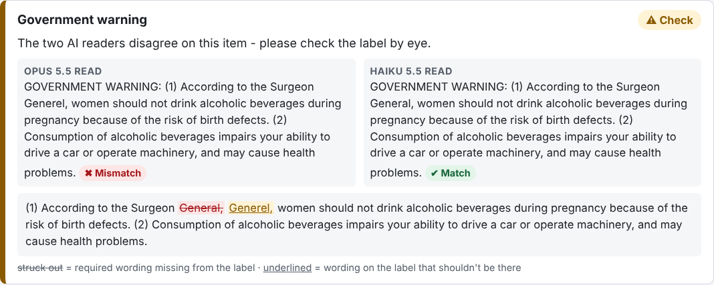

# Design decisions and trade-offs

This is the reasoning behind Label Check, written as a decision log. Each entry
gives the **context**, the **options** considered, the **decision**, its
**trade-offs**, and **when to revisit** it. Entries are grouped by area, not by
the order they were made.

Stakeholder quotes refer to the discovery interviews in the take-home brief.

**Contents**

* Architecture: [D1 Stack](#d1-stack-python--fastapi--plain-htmljs-one-container) · [D2 AI reads, code judges](#d2-the-ai-reads-plain-code-judges) · [D3 Structured output](#d3-schema-constrained-output-for-the-ai-reader)
* Reading the label: [D4 Hybrid AI + OCR](#d4-hybrid-extraction-ai-first-offline-ocr-fallback) · [D5 OCR grading](#d5-ocr-results-are-graded-more-cautiously) · [D6 OCR engineering](#d6-ocr-engineering-deskew-and-thread-limits)
* Model routing: [D7 Two readers](#d7-model-routing-two-independent-readers-double-keying) · [D8 Consensus rules](#d8-consensus-rules) · [D9 Model pairing](#d9-which-models) · [D10 Latency budget](#d10-the-5-second-budget) · [D11 Degraded modes](#d11-degraded-modes) · [D12 No server-side fallbacks](#d12-no-server-side-refusal-fallbacks)
* Judging: [D13 Verdict states](#d13-five-verdict-states-including-review) · [D14 Text matching](#d14-text-field-matching) · [D15 Numbers](#d15-abv-and-volume-are-compared-as-numbers) · [D16 Warning](#d16-the-government-warning-check)
* Product: [D17 Batch](#d17-batch-processing) · [D18 UI](#d18-ui-for-every-comfort-level) · [D19 Privacy](#d19-stateless-nothing-stored)
* Quality: [D20 Tests](#d20-testing-strategy) · [D21 Sample labels](#d21-synthetic-sample-labels) · [D22 Benchmark](#d22-benchmark-before-tuning)
* [Known limitations and next steps](#known-limitations-and-next-steps)

---

## Architecture

### D1. Stack: Python + FastAPI + plain HTML/JS, one container

**Context.** A prototype that must be deployed, used by non-technical agents,
and reviewed by engineers. Marcus: TTB is on Azure, and COLA is .NET.

**Options.** (a) Python/FastAPI; (b) Next.js/TypeScript; (c) .NET to match COLA.

**Decision.** Python/FastAPI with a framework-free HTML/JS front end, shipped as
one Docker image.

**Trade-offs.**
* ➕ Python has the best OCR and image tooling (Tesseract, Pillow) and a mature Anthropic SDK.
* ➕ No front-end build step, so there's nothing to compile and the client is easy to audit.
* ➕ One container runs on Render, Railway or Azure App Service unchanged.
* ➖ Doesn't match COLA's .NET stack. Acceptable: Marcus framed this as a standalone
  proof of concept that may inform procurement, not as code to merge into COLA.
* ➖ Vanilla JS gets unwieldy if the UI grows a lot. At this size, a framework
  would be more code than the app.

**Revisit if** the tool moves toward production integration with COLA.

### D2. The AI reads; plain code judges

**Context.** Pass/fail on a federal compliance check has to be explainable and consistent.

**Options.**
1. Ask the model "does this label comply with this application?"
2. Have the model only *transcribe* fields, and decide with deterministic rules.

**Decision.** Option 2. The models fill a fixed schema (`ExtractedLabel`). All
verdicts come from `app/matching.py` and `app/warning.py`.

**Trade-offs.**
* ➕ Every verdict traces to a rule with a unit test, and a prompt change can't
  silently change compliance policy.
* ➕ The same rules apply whatever produced the text (Opus, Haiku or OCR), which is
  what makes the fallback (D4) and the two-reader consensus (D7) possible.
* ➖ Fuzzy judgment ("is this obviously the same brand?") has to be written down as
  rules. I handle the grey zone with a REVIEW state (D13) rather than an AI opinion.

### D3. Schema-constrained output for the AI reader

**Decision.** Use `client.messages.parse(output_format=ExtractedLabel)`. The API
constrains the response to the Pydantic schema, and the SDK validates it.

**Trade-offs.**
* ➕ No JSON-parsing heuristics or retries for malformed output. The field
  descriptions in `ExtractedLabel` double as part of the prompt.
* ➖ Ties extraction to the schema shape; adding a field means a code change.
  That's acceptable, since a new field needs a new rule anyway.

---

## Reading the label

### D4. Hybrid extraction: AI first, offline OCR fallback

**Context.** Two interviews pull in opposite directions:
* Marcus: *"our network blocks outbound traffic to a lot of domains … half their
  features didn't work because our firewall blocked connections."*
* Jenny wants angled and glary photos handled, and the bold header checked. Only
  a vision model does that well.

**Options.**

| | Accuracy on bad photos | Bold check | Works behind firewall | Code size |
|---|---|---|---|---|
| AI only | High | Yes | ❌ | Small |
| OCR only | Low | No | ✅ | Small |
| **AI + OCR fallback** | High when reachable | Yes when reachable | ✅ (degraded) | Larger |

**Decision.** Hybrid. AI readers run first; if every one fails or misses the
deadline, Tesseract runs locally. `EXTRACTION_MODE=ocr` forces offline mode, and
`=claude` disables the fallback. The UI always states which reader was used and why.

**Trade-offs.**
* ➕ The tool still works if the AI endpoint is blocked or down, which was the exact
  failure of the previous vendor pilot.
* ➖ Two code paths to maintain and test.
* ➖ OCR results are weaker, so they need their own grading rules (D5).

### D5. OCR results are graded more cautiously

**Context.** OCR can't tell a typo on the label from its own misread, can't
prove a field is *absent*, and can't see font weight.

**Decision.** In OCR mode:
* "Not found" becomes REVIEW, not MISSING.
* A warning that differs only by look-alike words ("alcahalic") becomes REVIEW.
* Low mean OCR confidence (< 75) turns FAIL into REVIEW.
* Bold is always "unknown", so a perfect warning is still REVIEW.

Real violations still FAIL: the title-case header, reworded text, and a wrong ABV.

**Trade-offs.**
* ➕ OCR never produces a confident wrong FAIL from a misread. Before deskew,
  the angled sample "failed" with "label says 50 mL".
* ➖ In OCR mode a fully compliant label never reaches PASS, because bold can't be
  confirmed. That's the honest result, and it's the main reason the AI path is primary.

### D6. OCR engineering: deskew and thread limits

Two problems found in testing, and how each was fixed:

* **Angled photos defeated Tesseract.** I added projection-profile deskew using
  Pillow only. A thumbnail is rotated through ±15°, and the angle where text rows
  are sharpest wins: resizing to 1 px wide averages each row, and the variance
  peaks when lines are level.
  *Trade-off:* about 200 ms per label, and it assumes dark text on a light
  background.
* **Batch OCR hung.** Tesseract uses one OpenMP thread per core, so 4 parallel
  jobs oversubscribed the CPU and ran more than 60x slower.
  *Fix:* `OMP_THREAD_LIMIT=1`, with parallelism across processes instead, and
  OCR concurrency capped at the core count. The 9-label demo batch went from
  hanging to about 2 s.

---

## Model routing

### D7. Model routing: two independent readers ("double-keying")

**Context.** Two requirements shape this:
* The 5-second bar. Sarah: *"If we can't get results back in about 5 seconds,
  nobody's going to use it."*
* Exactness on the warning. Jenny: *"It has to be exact."*

**The key risk analysis.** The two possible errors aren't equal:
* **False FAIL:** an agent spends 30 seconds looking. Annoying.
* **False PASS:** a non-compliant label is approved. That's the error the tool must not make.

The most likely cause of a false PASS is a model **silently correcting a typo**
while transcribing. It reads "Surgeon Generel" and writes "Surgeon General".
Language models are trained toward fluent, correct text, and smaller models do
this more often. The output then looks *perfect*, so nothing downstream suspects it.

**Cost is not the driver.** Rough estimate: about 2,000 input and a few hundred
output tokens per label, so about 2¢ on Opus 5.5 and about 0.05¢ on Haiku 5.5. At
150,000 labels a year, even running Opus on everything is a few thousand dollars,
which is trivial next to 47 agents' time. So routing here is about **accuracy and
latency**, not saving money.

**Options.**

| Design | How | Latency | Catches a silent correction? | Complexity |
|---|---|---|---|---|
| A. Escalation chain | Fast model first; re-run on the strong one if anything fails | Fast when clean, slow when not (two calls back to back) | ❌ A clean-looking mistake never escalates | Low |
| B. Split by field | Fast model for simple fields, strong model only for the warning, in parallel | Slower of the two | Partly: only on the warning | Medium |
| **C. Two independent readers** | Two *different* models read everything at once; disagreements go to a human | Slower of the two | ✅ Two models rarely make the same correction | Medium |
| D. Backup request | Strong model; after ~3 s also send to the fast one; take the first answer | Cuts slow outliers | ❌ No accuracy gain | Low |

**Decision.** C, combined with a hard deadline (D10).

**Why not A**, the textbook escalation chain: it escalates on *suspicious*
results, and a silent correction produces a result that looks perfect. It
optimizes cost, which doesn't matter here, at the expense of the one error that
does.

**Trade-offs.**
* ➕ Agreement between independent readers is a confidence signal we *measure*,
  rather than asking a model how confident it is.
* ➕ Parallel calls: latency is about the slower reader, not the sum.
* ➕ The idea will be familiar to TTB staff: it's double-keying, as in data entry.
* ➖ Twice the API calls, and roughly 1.03x the cost if the second reader is Haiku.
* ➖ More labels reach REVIEW: every disagreement does. If the second reader is
  often wrong, the extra human work could erode trust ("cry wolf"). The
  benchmark's **→ Review** column measures this, and `SECONDARY_MODEL=""` turns it off.
* ➖ Latency is bounded by the *slower* reader, so the pairing needs a fast secondary.

### D8. Consensus rules

Implemented in `app/consensus.py`, with tests in `tests/test_consensus.py`.

**Verdicts are compared, not text.** Each reading runs through the normal
matching rules, and their *outcomes* are compared. "75 cl" and "750 mL" read by
two models aren't a disagreement, because both pass.

| Primary | Secondary | Result | Why |
|---|---|---|---|
| X | X (same) | X, *agreed* | Independent confirmation |
| PASS | anything else | **REVIEW**, *disputed*, both readings shown | One reader objects, so it can't be a clean pass |
| anything else | PASS | **REVIEW**, *disputed*, both readings shown | The silent-correction case |
| REVIEW | FAIL (or the reverse) | the more severe one, FAIL | Both already flag it; don't water down a FAIL |

**The safety property: a field can only PASS if every reader that answered passed it.**

**Alternative considered: on any disagreement, take the more severe verdict.**
Rejected. A misread by *either* model would then produce a confident FAIL,
which teaches agents to distrust FAILs. REVIEW gives the same protection
against false PASSes without manufacturing false FAILs.

**Simulated check** (`tests/test_benchmark_scoring.py`, not real model output):
on the 12 sample labels, a reader that silently "fixes" every warning typo
produces **5 false PASSes** on its own. Paired with a faithful reader, it produces
**0 false PASSes**, and those 5 labels go to REVIEW instead. That is the property
the design exists for, pinned as a regression test. Whether real models behave
like the "fixer" is what the benchmark (D22) measures.

**UI.** Disputed fields show each model's reading and verdict side by side, plus
the word diff from the reader that objected, so the agent sees exactly where to
look instead of comparing two paragraphs ("no hunting for buttons").

### D9. Which models

**Decision (provisional, pending the benchmark).**
* **Primary: `claude-opus-5-5`**, the most accurate transcription and the best at
  difficult photos and bold detection.
* **Secondary: `claude-haiku-5-5`**, which is fast and, importantly, a *different*
  model. It's run with `effort: low`.

**Why a different model, not two calls to the same one?** The same model tends to
make the same mistake twice; independence is the point. Different model tiers
have different training and failure modes.

**Alternatives.**
* `claude-sonnet-5-5` as the secondary: likely more accurate than Haiku but slower,
  and it may push the pair past the deadline.
* Sonnet + Haiku: faster, but gives up Opus's accuracy as the trusted
  single reader (D11).

**Revisit when** the benchmark runs (D22). The data, not intuition, should set the
pairing. Both models are environment variables (`PRIMARY_MODEL`, `SECONDARY_MODEL`).

### D10. The 5-second budget

**Decision.**
* Readers run **in parallel** under one shared **deadline** (`READ_DEADLINE_SECONDS`,
  default 4.5 s). Unfinished calls are cancelled.
* **`effort: low`**: less thinking, lower latency. Transcription doesn't need deep reasoning.
* Images are **downscaled to 1568 px** and sent as JPEG: fewer tokens, less upload time.
* **One SDK retry** on transient errors (429/5xx); the outer deadline still bounds the total.

**Trade-offs.**
* ➕ The agent never waits on a hung call.
* ➖ If *both* readers miss the deadline, OCR runs afterwards (about 1 s), so that
  path can reach about 5.5 s. I chose a slightly late answer over no answer.
  Running OCR in parallel from the start would avoid this but waste CPU on every
  label.
* ➖ A deadline tuned for normal latency will drop the secondary on slow days,
  which leaves a single-reader result (D11).
* ⚠️ **Not yet measured with real API calls** (no key in the build environment).
  The benchmark reports p50/p90 and the share of labels within 5 s per model and per pair.

### D11. Degraded modes

| Situation | Behaviour | Reasoning |
|---|---|---|
| Both readers answer | Consensus (D8) | Normal path |
| Only the **primary** answers | Its verdicts stand; the note says "not double-checked" | Same trust as the original single-reader design; the strongest model |
| Only the **secondary** answers | Its verdicts stand, **except a warning PASS becomes REVIEW** | Silent correction is the weaker model's characteristic failure, and the warning is where it matters |
| Neither answers in time / errors | Offline OCR (D4, D5) | Something is better than nothing, and it's clearly labelled |
| `SECONDARY_MODEL=""` | Single reader, no degradation note | An explicit configuration, not a failure |

**Trade-off.** Requiring two readers for *any* PASS would be stricter. But every
label would become REVIEW whenever Haiku is slow, and agents would learn to ignore REVIEW.

### D12. No server-side refusal fallbacks

The Claude API can retry a declined request on another model inside the same call
(`fallbacks`). **Not used.**
* We already have a second, independent reader, and a refusal from one model
  simply becomes the single-reader case (D11).
* A server-side retry inside a 4.5 s budget would usually miss the deadline anyway.
* Refusals on photos of alcohol labels should be very rare. If the benchmark or
  logs show otherwise, this is a few lines to add.

---

## Judging

### D13. Five verdict states, including REVIEW

`PASS · REVIEW · FAIL · MISSING · SKIPPED`. The overall verdict is FAIL if any
field is FAIL or MISSING, REVIEW if any is REVIEW, and PASS otherwise.

**Why REVIEW exists.** Dave: *"You can't just pattern match everything … You need
judgment."* A binary pass/fail forces the tool to guess in the grey zone. REVIEW
says "probably fine, look here", which is honest and saves the agent from
re-checking everything else.

**Trade-off.** If too much lands in REVIEW, the tool saves little time. The
benchmark tracks the review rate.

### D14. Text field matching

In order:
1. Exact match (whitespace collapsed) gives **PASS**.
2. The same after normalizing case, punctuation, curly quotes and "&" gives
   **PASS with a note**. This is Dave's `STONE'S THROW` vs `Stone's Throw`.
3. The application value appears as whole words inside the label text gives
   **PASS** ("Product of *Scotland*").
4. A similarity of 85% or more gives **REVIEW** (one-letter typo or misread).
5. The label shows only part of the value gives **REVIEW**.
6. Anything else gives **FAIL**.

**Trade-off.** The 0.85 threshold is a judgment call. Lower catches more
near-misses but flags more harmless differences. It's a named constant
(`REVIEW_SIMILARITY`) so it can be tuned against real data.

### D15. ABV and volume are compared as numbers

* `45% Alc./Vol.` = `45 % ALC/VOL`; `90 Proof` = 45%. The label's own proof is
  checked against its ABV for internal consistency.
* Volumes are converted to mL: `70 cl` = `700 mL`, with a 0.5% tolerance for unit rounding (fl oz).
* ABV must match **exactly**. TTB allows tolerances (for example ±0.3% for
  spirits), but tolerances apply to the *product's actual ABV vs the label*, not
  to the label vs the application, which should be identical.
* If no number can be parsed, the comparison falls back to text rules.

### D16. The government warning check

Per 27 CFR 16.21–16.22 and Jenny's notes:
* **Word-for-word**, including punctuation. A missing comma fails. Line breaks are layout and are ignored.
* **Body words** are compared case-insensitively; the regulation mandates
  capitals only for the lead-in.
* **The lead-in** must be `GOVERNMENT WARNING:`: capitals and a colon, with a
  separate, specific message for each problem.
* **Bold**: must be bold, as judged by the vision model. Unknown becomes REVIEW.
* On a mismatch, a **word-level diff** shows what's missing and what's extra.

**Known risk.** An AI reader might "correct" what it transcribes. Mitigated three ways:
1. The prompt explicitly forbids correction and explains why.
2. A second independent reader catches it (D7).
3. The benchmark measures it directly, with three subtle-typo sample labels.

---

## Product

### D17. Batch processing

Janet's request: importers send 200–300 labels at once.

**Decision.** Batch is many single checks, orchestrated by the browser: a CSV of
application rows plus the image files, with 4 requests in flight. The CSV is
parsed **server-side**, because quoted commas in addresses and Excel BOMs are
fiddly in browser JS.

**Trade-offs.**
* ➕ No job queue, database or stored images; live progress for free; results
  download as CSV.
* ➖ Closing the tab stops the batch. A production version should use a
  server-side queue with resumable jobs.
* ➖ With two readers, each label is two API calls, so a 300-label batch is 600
  calls. The server caps concurrency (`MAX_CONCURRENCY`) to stay inside rate limits.

### D18. UI for every comfort level

Sarah: *"something my mother could figure out … no hunting for buttons."*
* 18 px base text, numbered steps, one big primary button.
* Status is always **icon plus words**, never color alone.
* Plain-English notes on every field.
* "Try an example" menu so nobody needs test files.
* Dark mode, keyboard focus styles, and it works at phone width.

### D19. Stateless: nothing stored

Images are processed in memory and discarded, and nothing is written to disk or
a database. Marcus: *"PII considerations, document retention policies … for a
prototype, just don't do anything crazy."* Labels are sent to the Anthropic API
for reading; a production deployment needs that reviewed against TTB's data policies.

---

## Quality

### D20. Testing strategy

| Layer | What | Needs network or key? |
|---|---|---|
| `tests/test_matching.py` | Every matching and warning rule, including Dave's and Jenny's examples | No |
| `tests/test_consensus.py` | Every consensus and degraded-mode rule | No |
| `tests/test_api.py` | HTTP end to end: **real Tesseract** on sample images, **scripted fake models** (agree, disagree, slow, failing) | No |
| `tests/test_benchmark_scoring.py` | Benchmark scoring, plus the two-reader property, using simulated readers | No |
| `scripts/benchmark.py` | Real models, real latency, real accuracy | Yes, and it costs money |

**Why the models are faked in tests.** The tests check *our* logic (routing,
deadline and consensus) deterministically and for free. Model quality is a
separate question, answered by the benchmark, which shouldn't run on every commit.

### D21. Synthetic sample labels

`scripts/generate_samples.py` renders 12 labels, each targeting one rule from the
interviews: compliant, case difference, title-case warning, wrong ABV, reworded
warning, non-bold header, angled with glare, no warning, an import with cl units,
and three **subtle typos** (`Generel`, `alcohol beverages`, a missing comma) that test silent correction.

**Trade-off.** They're reproducible and the ground truth is known exactly, but
they're cleaner than real bottle photos. Real accuracy needs a set of real COLA images.

### D22. Benchmark before tuning

`scripts/benchmark.py` runs every model on every sample label (all models
concurrently, as in production) and scores each single model and each pairing
on: latency p50/p90 and the share within 5 s; exact warning transcription; **silent
corrections**; bold accuracy; verdict accuracy; **false PASS**; false FAIL; review
rate; and cost per label. Results go to `docs/benchmark-results.md`.

**Status:** written and ready; **not yet run**, because no API key was available
in the build environment. The pairing (D9) and the deadline (D10) should be
confirmed or changed from its results.

---

## Known limitations and next steps

* **Benchmark not yet run.** All model latency and accuracy statements are
  estimates until it is.
* **Real-world accuracy unknown.** Synthetic labels only; the next step is a set
  of real, anonymized COLA images with known outcomes.
* **No beverage-specific rules** (wine/beer ABV exemptions, type-size minimums,
  required-field rules by class).
* **Batch is browser-driven**, so it isn't resumable (D17).
* **Docker image not built in CI.** The build environment couldn't reach the
  Debian mirrors; the same install steps work on the host.
* **No auth or audit log.** Fine for a prototype, required for production.
